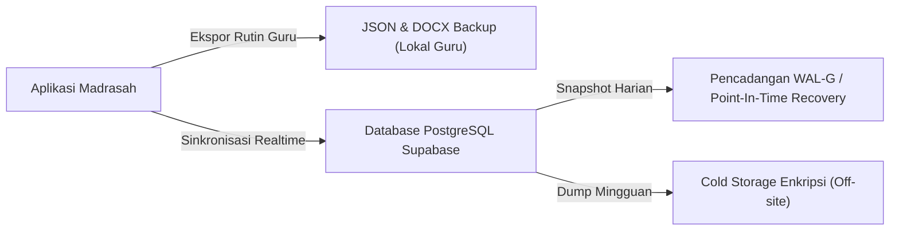

# MADRASAH KBC LEARNING SUITE — PANDUAN PENCADANGAN & PEMULIHAN BENCANA
**Kategori:** Disaster Recovery, Backup & Business Continuity  
**Standar Kepatuhan:** Keamanan Dokumen Pendidikan & Audit Madrasah  

---

## 1. Strategi Pencadangan (Backup Strategy)

Sistem mengadopsi pendekatan perlindungan berlapis (*multi-tier backup*):



---

## 2. Pencadangan Basis Data PostgreSQL

### A. Pencadangan Manual via pg_dump

Jalankan perintah berikut untuk mengekstrak seluruh data skema dan isi:
```bash
# Ganti kredensial host, port, user, dan dbname sesuai instans database Anda
pg_dump -h db.xxxxxxxxxxxx.supabase.co -U postgres -p 5432 -d postgres \
  --format=custom \
  --file="backup_madrasah_kbc_$(date +%Y%m%d_%H%M%S).dump"
```

Untuk mengekstrak khusus data terstruktur dalam bentuk SQL script:
```bash
pg_dump -h db.xxxxxxxxxxxx.supabase.co -U postgres -p 5432 -d postgres \
  --data-only \
  --schema=public \
  --file="backup_data_kbc_$(date +%Y%m%d).sql"
```

### B. Pencadangan Otomatis Supabase CLI
```bash
supabase db dump -f supabase_backup.sql
```

---

## 3. Pencadangan Cepat Berbasis JSON (Disaster Recovery Mandiri Guru)

Pada **Editor Dokumen** (`DocumentEditorPage.tsx`), setiap pendidik dapat melakukan pencadangan instan per modul ajar:
1. Klik tombol **Unduh Dokumen**.
2. Berkas tersimpan dalam format terstruktur:  
   `{Judul_Dokumen}_v{Nomor_Versi}.json`
3. Berkas JSON ini memuat seluruh metadata, komponen inti, tujuan, integrasi Panca Cinta, Deep Learning, dan kisi-kisi asesmen.

---

## 4. Prosedur Pemulihan Data (Restoration Procedure)

### A. Pemulihan Penuh Database (Full Restore)

1. Buat database baru atau kosongkan tabel yang korup.
2. Jalankan pemulihan biner:
```bash
pg_restore -h db.xxxxxxxxxxxx.supabase.co -U postgres -p 5432 -d postgres \
  --clean --if-exists \
  "backup_madrasah_kbc_YYYYMMDD_HHMMSS.dump"
```

3. Verifikasi integritas relasi:
```sql
SELECT count(*) FROM learning_documents;
SELECT count(*) FROM user_profiles;
SELECT count(*) FROM curriculum_references WHERE verification_status = 'terverifikasi';
```

### B. Pemulihan Dokumen Guru dari Riwayat Versi

1. Buka menu **Editor Dokumen**.
2. Pilih tab **Riwayat Versi**.
3. Pilih snapshot versi yang diinginkan (misal `v1.0`).
4. Klik **Pulihkan Versi Ini**. Seluruh editor akan kembali ke kondisi snapshot tersebut secara instan.

---

## 5. Kebijakan Retensi & RTO/RPO

| Metrik | Target Sasaran | Keterangan |
|---|---|---|
| **RPO (Recovery Point Objective)** | < 1 Jam | Kehilangan data maksimum jika terjadi insiden |
| **RTO (Recovery Time Objective)** | < 30 Menit | Waktu yang dibutuhkan untuk mengembalikan layanan |
| **Retensi Harian** | 7 Hari | Disimpan pada hot storage untuk pemulihan cepat |
| **Retensi Mingguan** | 4 Pekan | Arsip akhir pekan |
| **Retensi Semester/Tahunan** | 5 Tahun | Arsip resmi berkas kurikulum untuk keperluan akreditasi |
